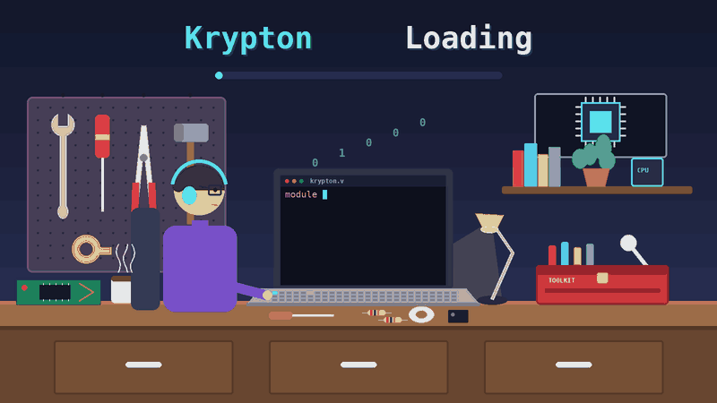

<div align="center">


<!-- ⌨️ Typing animation -->
<a href="https://github.com/Blue-Rangoon/Krypton-Core">
  
</a>


<!-- 🎞️ IMAGE 2: animated loading GIF (krypton-loading.gif) -->
<!--  -->

<!-- <br><br> -->

[](https://riscv.org/)
[](https://www.chisel-lang.org/)
[](https://www.scala-lang.org/)
[](https://www.scala-sbt.org/)
[](https://gtkwave.sourceforge.net/)
[](LICENSE)

**[🧠 About](#-about-krypton-core)** •
**[🏗️ Datapath](#️-risc-v-single-cycle-datapath)** •
**[🔩 Components](#-processor-components)** •
**[🚀 Quick Start](#-quick-start)** •
**[🌊 GTKWave](#-gtkwave)** •
**[🌀 Fibonacci](#-fibonacci-demonstration)**

</div>

---

## ✨ Overview

**Krypton-Core** is a single-cycle **RV32I RISC-V processor** designed and implemented in **Scala + Chisel**.

It brings together a full processor datapath: instruction memory, register file, ALU, control logic, data memory, branch handling and next-PC generation. Every run can be dumped to a VCD and inspected **cycle by cycle in GTKWave**.

```text
⚡ ISA          →  RV32I (RISC-V 32-bit base integer)
🧬 Design Style →  Single-cycle, one instruction per clock
🛠️ Language     →  Scala + Chisel (hardware construction)
🧪 Verification →  ChiselTest + GTKWave waveforms
```

---

## 🧠 About Krypton-Core

Krypton-Core is a **single-cycle RISC-V processor**: every instruction travels through the whole datapath within one clock cycle.

The core follows the classic RISC-V execution flow:

> **Fetch → Decode → Execute → Memory → Write Back → Next PC**

Because the whole design is written in **Chisel**, the hardware is describable, testable, and ready for RTL generation.

---

## 🎯 Highlights

| | Feature |
| :-: | :-- |
| 🧩 | **Modular design**: every block (ALU, RegFile, Controller...) is its own Chisel module |
| ⏱️ | **Single-cycle execution**: simple, easy-to-follow datapath |
| 🔀 | **Branch + Jump support**: branch logic and JAL/JALR handling |
| 📝 | **Swappable programs**: load different instruction files into instruction memory |
| 🌊 | **Waveform debugging**: generate VCDs and step through every clock cycle |
| 🧪 | **Testable**: run hardware tests straight from SBT |

---

## 🏗️ RISC-V Single-Cycle Datapath

<!-- 🖼️ IMAGE 3: RISC-V datapath diagram. Save it as images/RiscV_DataPath.jpeg (no spaces in the filename) -->
<p align="center">
  <a href="images/RiscV_DataPath.jpeg">
    
  </a>
</p>

The datapath connects the major processor components to execute RISC-V instructions.

### Core Flow

```text
            ┌─────────────┐
            │     PC      │
            └──────┬──────┘
                   ↓
         ┌──────────────────┐
         │ Instruction Mem  │
         └────────┬─────────┘
                  ↓
         ┌──────────────────┐
         │     Decode       │
         └────────┬─────────┘
                  ↓
      ┌───────────┴───────────┐
      ↓                       ↓
┌─────────────┐       ┌──────────────┐
│ Register    │       │ Immediate    │
│ File        │       │ Generator    │
└──────┬──────┘       └──────┬───────┘
       └──────────┬───────────┘
                  ↓
            ┌──────────┐
            │   ALU    │
            └────┬─────┘
                 ↓
       ┌─────────┴─────────┐
       ↓                   ↓
┌─────────────┐      ┌─────────────┐
│ Data Memory │      │   Next PC   │
└──────┬──────┘      └──────┬──────┘
       └──────────┬─────────┘
                  ↓
           ┌────────────┐
           │ Write Back │
           └────────────┘
```

---

## 🔩 Processor Components

| Component                  | Responsibility                             |
| -------------------------- | ------------------------------------------ |
| 🧭 **Program Counter**     | Holds the current instruction address      |
| 📖 **Instruction Memory**  | Fetches instructions                       |
| 🧩 **Instruction Decoder** | Identifies the instruction type            |
| 🎛️ **Controller**          | Generates processor control signals        |
| 🗃️ **Register File**       | Reads and writes RISC-V registers          |
| 🔢 **Immediate Generator** | Generates instruction immediates           |
| ⚙️ **ALU Control**         | Selects the required ALU operation         |
| 🧮 **ALU**                 | Performs arithmetic and logical operations |
| 💾 **Data Memory**         | Handles load/store operations              |
| 🔀 **Branch Logic**        | Determines branch conditions               |
| 🏃 **JAL/JALR Logic**      | Handles jump instructions                  |
| ➡️ **Next-PC Logic**       | Determines the next instruction address    |

---

## 📂 Repository Structure

<details>
<summary><b>Click to expand the project tree</b></summary>

```text
Krypton-Core/
│
├── 📁 images/                  # Banner, datapath diagram, GIF
├── 📁 project/                 # SBT project configuration
├── 📁 src/
│   ├── main/scala/core/
│   │   ├── ALU.scala
│   │   ├── InstMem.scala
│   │   ├── Top.scala
│   │   ├── RegFile.scala
│   │   ├── DataMem.scala
│   │   ├── Controller.scala
│   │   ├── Imm_gen.scala
│   │   └── ...
│   └── test/scala/core/        # ChiselTest testbenches
├── 📁 target/
├── 📁 test_run_dir/            # Generated test + VCD files
│
├── 📄 Assembly instructions.txt
├── 📄 fibonaciAssembly.txt
├── 📄 instruction.txt
├── 📄 build.sbt
├── 📄 LICENSE
└── 📄 README.md
```

</details>

---

## 📝 Instruction Programs

Krypton-Core loads different instruction programs through the Instruction Memory.

| File | What it contains |
| :-- | :-- |
| 📘 `Assembly instructions.txt` | Assembly instructions for the main program |
| 🌀 `fibonaciAssembly.txt` | Assembly implementation of the Fibonacci program |
| 🔢 `instruction.txt` | Instruction data used by the processor |

---

## 🔄 Selecting a Program

The program executed by Krypton-Core is selected in `InstMem.scala` and `Top.scala`.

### 1️⃣ Configure Instruction Memory

Open `src/main/scala/core/InstMem.scala` and find:

```scala
class InstMem(initFile: String = "fibonaciAssembly.txt") extends Module with Config4
```

Change the filename to the program you want to run:

```scala
// Fibonacci
class InstMem(initFile: String = "fibonaciAssembly.txt") extends Module with Config4

// Main assembly program
class InstMem(initFile: String = "Assembly instructions.txt") extends Module with Config4
```

### 2️⃣ Configure the Top Module

Open `src/main/scala/core/Top.scala` and find:

```scala
class Top(initFile: String = "fibonaciAssembly.txt") extends Module
```

Change the filename to match the selected program:

```scala
class Top(initFile: String = "Assembly instructions.txt") extends Module
```

> 💡 **Tip:** Use the same filename in both files so the program stays consistent.

---

## ⚡ Quick Start

```bash
# 1. Clone
git clone https://github.com/Blue-Rangoon/Krypton-Core.git

# 2. Enter the project
cd Krypton-Core

# 3. Start SBT
sbt
```

Inside SBT:

```bash
# 4. Run the processor test
testOnly core.TopTest

# 5. Run it and generate a waveform
testOnly core.TopTest -- -DwriteVcd=1
```

Then open the waveform:

```bash
gtkwave <generated-vcd-file>
```

> You should see the SBT prompt, for example `sbt:RISCV_Project>`

The general test format is:

```bash
testOnly core.<TestName>
```

---

## 🌊 GTKWave

The important option for waveform generation is:

```text
-DwriteVcd=1
```

After the test finishes, open `test_run_dir/`, find the directory generated for the test, and open the VCD inside it:

```bash
gtkwave TopTest.vcd
```

<!-- 🖼️ IMAGE 4 (optional): screenshot of your GTKWave waveform. Save as images/gtkwave-waveform.png and uncomment the block below -->
<!--
<p align="center">
  
</p>
-->

### 🔬 What Can Be Observed?

GTKWave lets you inspect the processor **cycle by cycle**.

```text
⏱ Clock          📍 PC             📖 Instruction
🧮 ALU            🗃 Register File   💾 Data Memory
🎛 Control Signals 🔀 Branch Signals  ➡ Next PC
📤 Register Output
```

Follow the whole execution by stepping through the clock cycles:

```text
Clock Cycle 1  →  Instruction 1
Clock Cycle 2  →  Instruction 2
Clock Cycle 3  →  Instruction 3
        ...
Clock Cycle N  →  Instruction N
```

This gives a hardware-level view of how the RISC-V processor executes a program.

---

## 🌀 Fibonacci Demonstration

One of the programs shipped with Krypton-Core is a Fibonacci implementation, stored in `fibonaciAssembly.txt`.

**Run it in 4 steps:**

1. Set `fibonaciAssembly.txt` in both `InstMem.scala` and `Top.scala`
2. Start SBT with `sbt`
3. Run `testOnly core.TopTest` (or add `-- -DwriteVcd=1` for a waveform)
4. Inspect the generated VCD in GTKWave

---

## 🧪 Verification Workflow


---

## 🛠️ Technologies

| Technology          | Used For                     |
| ------------------- | ---------------------------- |
| 🟠 **Chisel**       | Hardware Construction        |
| 🔴 **Scala**        | Hardware Description         |
| 🟢 **RISC-V RV32I** | Instruction Set Architecture |
| 🔵 **SBT**          | Build & Testing              |
| 🟣 **ChiselTest**   | Hardware Verification        |
| 🌊 **GTKWave**      | Waveform Analysis            |

---

## 🎯 Project Goals

Krypton-Core was built to explore the design and implementation of a RISC-V processor at the hardware level.

- 🧠 Understand the RISC-V architecture
- ⚙️ Design a single-cycle datapath
- 🔧 Implement processor components in Chisel
- 🧩 Connect datapath and control logic
- 🧪 Test hardware modules
- 📊 Generate VCD waveforms
- 🌊 Debug processor execution with GTKWave

---

## 📚 RISC-V

Krypton-Core is based on the **RISC-V RV32I** instruction-set architecture, built around these fundamentals:

```text
Registers + ALU + Memory + Control + Program Counter
                       ↓
              Instruction Execution
```

---

## 🤝 Connect

<div align="center">

**Built by [Blue Rangoon](https://github.com/Blue-Rangoon)**

[](https://github.com/Blue-Rangoon)
[](https://linkedin.com/in/saad-ali-rizvi)

<!-- ✏️ Replace "Your Name" and "your-linkedin-id" above with your real details -->

<br>

> *A clean and simple single-cycle RV32I processor implemented in Chisel.*

⭐ If you find this project useful, consider giving the repository a star!


</div>

